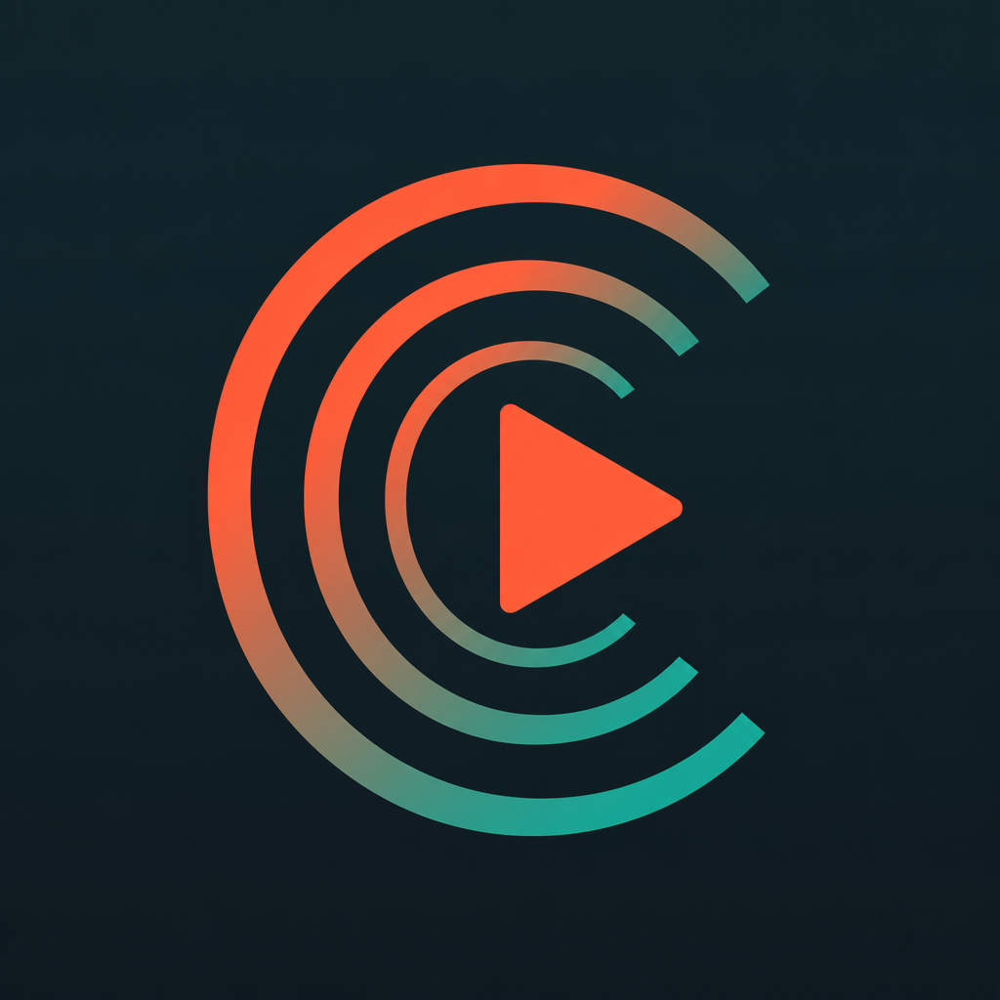
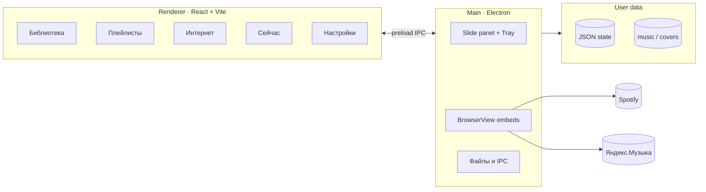

<p align="center">
  
</p>

<p align="center">
  
</p>

<h1 align="center">Resona</h1>

<p align="center">
  <strong>Музыка рядом</strong> — десктопный плеер для Windows,<br/>
  который выезжает с края экрана по одной клавише.
</p>

<p align="center">
  <a href="https://github.com/Dente22/Resona-music-nearby/releases/latest"></a>
  <a href="LICENSE"></a>
  <a href="https://github.com/Dente22/Resona-music-nearby/releases"></a>
</p>

<p align="center">
  
  
  
  
  
  
</p>

<p align="center">
  <a href="#-скачать"><strong>Скачать</strong></a> ·
  <a href="#-возможности"><strong>Возможности</strong></a> ·
  <a href="#-быстрый-старт"><strong>Быстрый старт</strong></a> ·
  <a href="#-архитектура"><strong>Архитектура</strong></a> ·
  <a href="#-контрибьют"><strong>Контрибьют</strong></a>
</p>

---

## Зачем Resona

Обычные плееры — это ещё одно тяжёлое окно. Resona живёт в **системном трее** и появляется как **боковая панель**: нажал `F9` — музыка рядом, нажал снова — исчезла.

Один интерфейс для:

- локальных файлов (офлайн)
- **Spotify** и **Яндекс.Музыки** (встроенный браузер + сессия)
- смешанных плейлистов: локальные треки и стрим в одном списке

---

## Скачать

Готовый установщик Windows (NSIS, RU / EN):

**[⬇ Resona Setup — последний релиз](https://github.com/Dente22/Resona-music-nearby/releases/latest)**

| | |
|---|---|
| Файл | `Resona-Setup-x.y.z.exe` |
| Архитектура | Windows **x64** |
| Установка | выбор папки · ярлыки · лицензия MIT |
| После установки | трей + горячая клавиша (по умолчанию **F9**) |

> Переустанавливайте поверх предыдущей версии — настройки лежат в `%AppData%/Resona/`.

---

## Возможности

<table>
<tr>
<td width="50%" valign="top">

### Панель всегда под рукой
- Выезд **слева** или **справа**
- Горячая клавиша (рекомендуется `F9`)
- Иконка в трее: открыть / скрыть / выход
- Запуск свёрнутым — без окна на рабочем столе

### Локальная библиотека
- MP3, WAV, FLAC, OGG, M4A, AAC
- Добавление файлов и сканирование папок
- Поиск, фильтры, удаление
- Метаданные и обложки

</td>
<td width="50%" valign="top">

### Интернет-музыка
- Вход в **Spotify** и **Яндекс.Музыку** как на сайте
- Сессия сохраняется внутри Resona
- Импорт треков / плейлистов по ссылке
- Смешанные плейлисты (локально + стрим)

### Удобство
- Тема: светлая / тёмная
- Язык: **русский** / English
- Громкость, автоскан папок
- Discover: поиск и импорт по ссылкам

</td>
</tr>
</table>

### Как это ощущается

```text
  ┌──────────────────────────────────────────────┐
  │  Рабочий стол                                │
  │                                         ┌────┤
  │                                         │ ♪  │  ← Resona
  │              F9  ↔  показать / скрыть   │ ██ │     slide-in
  │                                         │ ▶︎ │     panel
  │                                         └────┤
  └──────────────────────────────────────────────┘
         ▲
    трей / хоткей
```

---

## Быстрый старт

### Из исходников

Требования: **Node.js 20+**, Windows.

```bash
git clone https://github.com/Dente22/Resona-music-nearby.git
cd Resona-music-nearby
npm install
npm run electron:dev
```

Или двойной клик по `run-app.bat`.

### Скрипты

| Команда | Описание |
|--------|----------|
| `npm run electron:dev` | Dev-режим (Vite + Electron) |
| `npm run electron:build` | Сборка NSIS-установщика → `release/` |
| `npm test` | Unit-тесты (Vitest) |
| `npm run test:coverage` | Покрытие |
| `npm run test:e2e` | E2E (Playwright) |
| `npm run icons` | Генерация `.ico` / `.png` из бренда |

---

## Архитектура



| Слой | Путь | Роль |
|------|------|------|
| UI | `src/app/` | React-интерфейс панели |
| Domain | `src/lib/` | Плеер, стриминг, i18n, токены |
| Electron | `electron/` | Окно, трей, BrowserView, IPC |
| Tests | `tests/` | Vitest · сценарии TDD |
| Build | `electron-builder.json` | NSIS · иконки · branding |

---

## Где хранятся данные

Пользовательские данные **не** лежат в `src/` и **не** коммитятся.

| Режим | Корень |
|------|--------|
| `electron:dev` | `userdata/` в корне проекта |
| Установленное приложение | `%AppData%/Resona/` |

```text
userdata/  (или %AppData%/Resona/)
├── data/
│   ├── library.json
│   ├── playlists.json
│   ├── settings.json
│   ├── streaming-library.json
│   ├── embed-playback.json
│   └── streaming-auth.json
├── music/          # локальные копии треков
├── covers/         # обложки
└── app.log
```

Между `userdata/` и `%AppData%` данные **не мигрируют** автоматически.

---

## Структура репозитория

```text
Resona/
├── assets/                 # бренд: иконка, README-баннер
├── build/                  # иконки установщика (.ico, .bmp, .nsh)
├── electron/               # main process
├── src/
│   ├── app/                # React UI
│   └── lib/                # бизнес-логика
├── scripts/                # icons, branding, afterPack, installer assets
├── tests/                  # unit / integration
├── public/                 # favicon + icon для UI
├── electron-builder.json   # Windows NSIS
└── LICENSE                 # MIT
```

---

## Стек

<p>
  
  
  
  
  
  
  
  
</p>

- **music-metadata** — теги и длительность локальных файлов  
- **Radix UI** — доступные контролы (диалоги, слайдеры)  
- **NSIS** — мастер установки с RU/EN и брендированной боковой панелью  

---

## Roadmap

- [x] Slide-in панель + трей + хоткей  
- [x] Локальная библиотека и плейлисты  
- [x] Spotify / Яндекс embed  
- [x] Брендинг Resona + NSIS-установщик  
- [ ] Надёжная громкость для встроенных стримов  
- [ ] macOS / Linux сборки  
- [ ] Автообновления через GitHub Releases  

Идеи и баги — в [Issues](https://github.com/Dente22/Resona-music-nearby/issues).

---

## Контрибьют

Любые PR приветствуются.

1. Fork → ветка `feat/...` или `fix/...`  
2. `npm test` перед пушем  
3. Conventional commits: `feat:`, `fix:`, `docs:`, `test:`, `chore:`  
4. Короткое описание «зачем», не только «что»  

Для ассетов, которые нужно держать в git, используйте `uploads/` (см. `uploads/README.md`).

---

## Лицензия

Распространяется под **[MIT License](LICENSE)** — используйте, изучайте, форкайте.

---

<p align="center">
  
  <br/>
  <sub><b>Resona</b> — музыка рядом · сделано с заботой о фокусе</sub>
  <br/><br/>
  <a href="https://github.com/Dente22/Resona-music-nearby/stargazers">⭐ Star</a>
  ·
  <a href="https://github.com/Dente22/Resona-music-nearby/releases/latest">⬇ Download</a>
  ·
  <a href="https://github.com/Dente22/Resona-music-nearby/issues">💬 Issues</a>
</p>
